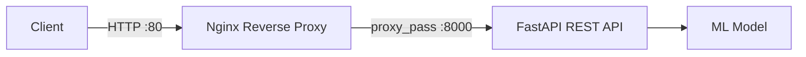
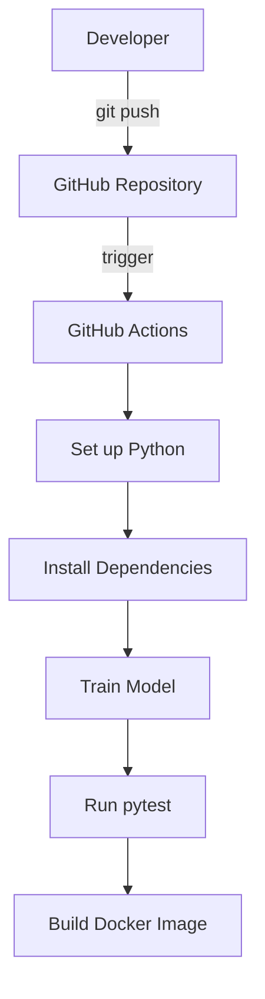
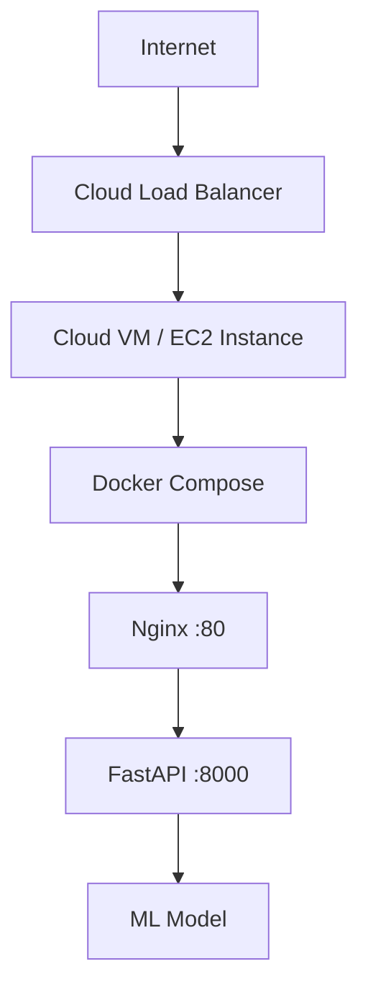

# Cloud-Native AI Prediction API with CI/CD

A production-style REST API serving machine-learning predictions, built with **FastAPI**, containerized with **Docker**, fronted by an **Nginx** reverse proxy, and continuously tested via **GitHub Actions**.

The API uses a **Gradient Boosting Regressor** trained on the [California Housing dataset](https://scikit-learn.org/stable/datasets/real_world.html#california-housing-dataset) to predict median house values.

---

## Architecture

### Request Flow



### CI/CD Pipeline



---

## Features

- **REST API** — FastAPI with automatic OpenAPI docs
- **ML Inference** — Gradient Boosting model via scikit-learn
- **Docker Containerization** — Multi-stage build with non-root user
- **Nginx Reverse Proxy** — Production-style traffic routing
- **Docker Compose** — One-command orchestration
- **Automated Testing** — pytest with full endpoint coverage
- **GitHub Actions CI** — Automated test + build pipeline
- **Health Checks** — Container and application-level
- **Structured Logging** — Request and error tracking

---

## Tech Stack

| Layer         | Technology                     |
|---------------|--------------------------------|
| Language      | Python 3.11+                   |
| Framework     | FastAPI + Uvicorn              |
| ML            | scikit-learn, pandas, joblib   |
| Validation    | Pydantic v2                    |
| Container     | Docker (multi-stage, slim)     |
| Orchestration | Docker Compose                 |
| Proxy         | Nginx                          |
| CI/CD         | GitHub Actions                 |
| Testing       | pytest                         |

---

## Local Setup

### Prerequisites

- Python 3.11+
- pip
- Docker Desktop (for containerized run)
- Git

### 1. Clone the repository

```bash
git clone https://github.com/Riansinu/cloud-native-ai-api.git
cd cloud-native-ai-api
```

### 2. Create a virtual environment (optional but recommended)

```bash
python -m venv .venv
# Windows
.venv\Scripts\activate
# macOS / Linux
source .venv/bin/activate
```

### 3. Install dependencies

```bash
pip install -r requirements.txt
```

### 4. Train the model

```bash
python ml/train.py
```

This trains a Gradient Boosting Regressor and saves it to `models/model.joblib`.

### 5. Run the API locally

```bash
uvicorn app.main:app --reload
```

The API is available at `http://localhost:8000` and interactive docs at `http://localhost:8000/docs`.

---

## API Endpoints

### `GET /` — API Info

```bash
curl http://localhost:8000/
```

```json
{
  "name": "Cloud-Native AI Prediction API",
  "version": "1.0.0",
  "description": "REST API for California Housing price predictions",
  "docs_url": "/docs"
}
```

### `GET /health` — Health Check

```bash
curl http://localhost:8000/health
```

```json
{
  "status": "healthy"
}
```

### `GET /model-info` — Model Information

```bash
curl http://localhost:8000/model-info
```

```json
{
  "model_name": "California Housing Price Predictor",
  "model_version": "1.0.0",
  "features": ["MedInc", "HouseAge", "AveRooms", "AveBedrms", "Population", "AveOccup", "Latitude", "Longitude"],
  "description": "Gradient Boosting Regressor trained on the California Housing dataset..."
}
```

### `POST /predict` — Make a Prediction

```bash
curl -X POST http://localhost:8000/predict \
  -H "Content-Type: application/json" \
  -d '{
    "MedInc": 3.5,
    "HouseAge": 25.0,
    "AveRooms": 5.0,
    "AveBedrms": 1.0,
    "Population": 1500.0,
    "AveOccup": 3.0,
    "Latitude": 37.5,
    "Longitude": -122.0
  }'
```

```json
{
  "predicted_price": 1.7234,
  "model_name": "California Housing Price Predictor",
  "model_version": "1.0.0"
}
```

> The predicted price is in **hundreds of thousands of USD** (e.g., `1.72` ≈ $172,000).

---

## Docker Usage

### Build and run the API container

```bash
docker build -t cloud-ai-api .
docker run -p 8000:8000 cloud-ai-api
```

### Run with Docker Compose (API + Nginx)

```bash
docker compose up --build
```

This starts:
- **FastAPI** on port `8000`
- **Nginx** on port `80` (reverse proxy → FastAPI)

Access the API through Nginx at `http://localhost` or directly at `http://localhost:8000`.

### Stop the services

```bash
docker compose down
```

---

## Testing

Run the full test suite:

```bash
pytest -v
```

Tests cover:
- `GET /` — returns API info
- `GET /health` — returns healthy status
- `GET /model-info` — returns model metadata
- `POST /predict` — valid predictions
- `POST /predict` — validation errors (missing fields, out-of-range values, wrong types)

---

## CI/CD

The GitHub Actions workflow (`.github/workflows/ci.yml`) runs on every push and pull request to `main`:

1. **Checkout** code
2. **Set up** Python 3.11
3. **Install** dependencies
4. **Train** the model
5. **Run** pytest
6. **Build** Docker image

The pipeline fails if any test fails. No cloud credentials are required.

---

## Cloud Deployment Architecture

> **Note:** This project runs entirely locally. The section below describes how it *could* be deployed to the cloud.

The Dockerized application is cloud-ready and could be deployed to a cloud VM (e.g., AWS EC2, GCP Compute Engine, Azure VM) with minimal changes:



**Steps for cloud deployment:**

1. Provision a VM instance (e.g., AWS EC2 `t3.micro`)
2. Install Docker and Docker Compose on the VM
3. Clone the repository
4. Run `docker compose up --build -d`
5. Configure the VM's security group to allow HTTP traffic on port 80
6. (Optional) Attach a domain name and add TLS via Let's Encrypt

The same Docker Compose setup used locally works identically on a cloud VM.

---

## Project Structure

```
cloud-ai-api/
├── app/
│   ├── __init__.py
│   ├── main.py            # FastAPI application
│   ├── schemas.py          # Pydantic request/response models
│   ├── model.py            # ML model loading
│   └── services/
│       ├── __init__.py
│       └── prediction.py   # Prediction business logic
├── ml/
│   └── train.py            # Model training script
├── models/
│   └── .gitkeep            # Placeholder (model saved here)
├── tests/
│   └── test_api.py         # API tests
├── nginx/
│   └── nginx.conf          # Nginx reverse proxy config
├── .github/
│   └── workflows/
│       └── ci.yml          # GitHub Actions CI pipeline
├── Dockerfile              # Multi-stage Docker build
├── docker-compose.yml      # Container orchestration
├── requirements.txt        # Python dependencies
├── .dockerignore
├── .gitignore
├── README.md
└── LICENSE
```

---

## License

MIT — see [LICENSE](LICENSE).
